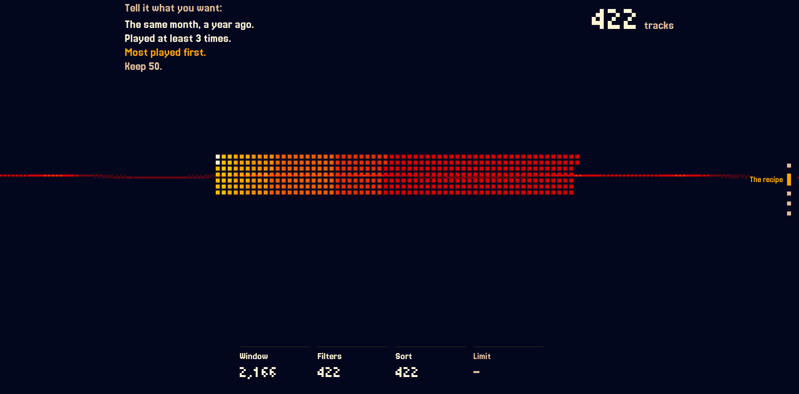

<div align="center">


**Describe a playlist once. It keeps coming.**

ListFM reads everything you've played on Last.fm and builds your playlists by itself, on your schedule.

[](./LICENSE)
[](https://github.com/Doggo785/ListFM/actions/workflows/ci.yml)
[](https://app.codacy.com/gh/Doggo785/ListFM/dashboard)

[How it works](#how-it-works) · [Self-hosting](#self-hosting) · [Local dev](#local-dev) · [Stack](#stack) · [Privacy](#privacy)

</div>

## How it works



1. **Link Last.fm.** Your whole listening history is imported once, newest first, then kept up to date.
2. **Write a recipe.** A window (the last 30 days, the same month a year ago, everything), filters (tags, play counts, first listen, top artists, time of day), a sort and limits. The live preview shows what it would give right now.
3. **Pick a schedule**, or press Run now.
4. **Get a playlist** each time it runs, frozen as it was, with a cover and its history. Copy it to your streaming app in two clicks.

Since Last.fm logs what you play on every app, the playlists follow your real taste, not one app's.

## Self-hosting

ListFM ships as a Docker Compose stack: Postgres, the API (migrations run at start), and nginx serving the site and `/api`. It assumes one API worker: the scheduler and rate limits live in its memory.

```bash
git clone https://github.com/Doggo785/ListFM.git && cd ListFM
# Set the variables below in the environment or in a .env next to compose.yaml, then:
docker compose up -d --build
```

Put a reverse proxy with HTTPS in front of the `web` service (port 80). For example on Coolify: create a Docker Compose resource from the repo, give the domain to `web`, and fill the variables in its UI.

| Variable | Required | Notes |
|---|---|---|
| `PUBLIC_URL` | Yes | The site's address, e.g. `https://listfm.example.com` |
| `POSTGRES_PASSWORD` | Yes | |
| `LASTFM_API_KEY` / `LASTFM_API_SECRET` | Yes | Free at [last.fm/api](https://www.last.fm/api/account/create) |
| `JWT_SECRET` | Yes | At least 32 characters: `openssl rand -hex 32` |
| `SMTP_HOST` / `SMTP_USER` / `SMTP_PASSWORD` | Yes | Sends the confirmation and reset links. `SMTP_PORT` defaults to `465` (SSL) |
| `MAIL_FROM` | Yes | The sender, e.g. `ListFM <listfm@example.com>`: an address your SMTP account may send as |
| `TRUSTED_IP_HEADER` | No | Where the visitor's IP is read, for the rate limits. Defaults to `X-Real-IP`, set by the bundled nginx. Behind Cloudflare: `CF-Connecting-IP`. Behind another proxy, the visitors all share its address unless you name a header that proxy overwrites |
| `GOOGLE_OAUTH_CLIENT_*` / `DISCORD_OAUTH_CLIENT_*` | No | `_ID` and `_SECRET`. The button shows when both are set. Redirect URI: `PUBLIC_URL/api/auth/google/callback` (or `discord`) |

Back up the `listfm-db` volume, for example with `docker compose exec db pg_dump -U listfm listfm`.

If you run it for other people, rewrite `frontend/src/views/Privacy.jsx`: it describes this instance and names its publisher.

## Local dev

Needs Python 3.14, Node 24, Docker, and a Last.fm API account.

```bash
cp .env.example .env            # fill in the Last.fm keys and JWT_SECRET
python -m venv .venv && source .venv/bin/activate
pip install -r backend/requirements.txt
(cd frontend && npm install)

docker run -d --name listfm-db -p 5433:5432 \
  -e POSTGRES_USER=listfm -e POSTGRES_PASSWORD=listfm -e POSTGRES_DB=listfm postgres:16
(cd backend && alembic upgrade head)

./dev.sh                        # API on :8000, site on http://localhost:5173
```

Without `SMTP_HOST`, mails are printed in the API console. `.env.example` lists every variable. Before a push, `scripts/ci-local.sh` runs the same checks as CI. More in [CONTRIBUTING.md](./CONTRIBUTING.md).

## Stack

FastAPI, async SQLAlchemy, Postgres and Alembic on Python 3.14. React 19, Vite and Tailwind 4 in JSX, with a WebGL pixel ribbon drawn in `lib/pixelRibbon.js`. GitHub Actions runs tests, lint, types, coverage, and secret and dependency scans.

## Privacy

No tracking, no ads, no analytics, no IP kept. Tokens live in httpOnly cookies. Deleting your account erases your listens, automations and playlists. The full list of what is kept and who sees it is on the site's `/privacy` page.

## License

MIT. See [LICENSE](./LICENSE).
